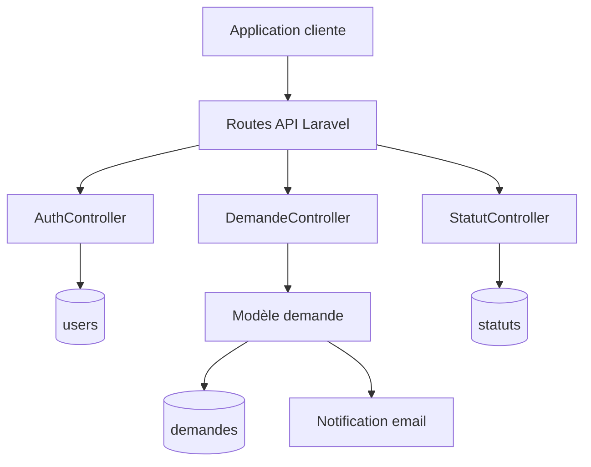

# Backend ASM

> API Laravel pour la gestion des demandes de pause des employés, leur suivi par statut et les tableaux de bord administrateur et employé.

[](https://laravel.com/)
[](https://www.php.net/)
[](LICENSE)

## Sommaire

- [Présentation](#présentation)
- [Fonctionnalités](#fonctionnalités)
- [Stack technique](#stack-technique)
- [Architecture](#architecture)
- [Installation](#installation)
- [Configuration](#configuration)
- [Exécution](#exécution)
- [API](#api)
- [Tests](#tests)

## Présentation

Backend ASM est une API REST construite avec Laravel. Elle permet aux employés de créer et consulter leurs demandes de pause, tandis que les administrateurs peuvent les suivre, modifier leur statut et consulter des indicateurs de synthèse.

Lors de la création d'une demande, l'API applique automatiquement les règles métier suivantes :

- la durée de la pause doit être positive ;
- le total des pauses d'un employé ne doit pas dépasser **2 heures par jour** ;
- le total des pauses d'un employé ne doit pas dépasser **8 heures par mois** ;
- un email de notification est envoyé à l'administrateur.

## Fonctionnalités

- Inscription, connexion et déconnexion avec Laravel Sanctum.
- Gestion des utilisateurs et distinction administrateur/employé.
- Création, consultation et suppression des demandes de pause.
- Filtrage des demandes par utilisateur connecté.
- Gestion des statuts : en attente, accepté et refusé.
- Mise à jour du statut d'une demande.
- Notifications email lors de la création d'une demande.
- Statistiques globales et statistiques propres à un employé :
  - nombre total de demandes ;
  - demandes acceptées ou refusées ;
  - répartition par mois et par semaine ;
  - dernières demandes ;
  - demandes en attente.
- Pagination des listes retournées par l'API.

## Stack technique

| Domaine | Technologies |
| --- | --- |
| Framework | Laravel 10 |
| Langage | PHP 8.1+ |
| API | Laravel Routing, JSON REST |
| Authentification | Laravel Sanctum |
| Base de données | MySQL |
| ORM | Eloquent |
| Email | Laravel Mail / SMTP |
| Tests | PHPUnit |

## Architecture



Le code applicatif est organisé par responsabilité :

```text
app/
├── Http/Controllers/  # Contrôleurs d'authentification, demandes et statuts
├── Mail/              # Notifications email
├── Models/            # Modèles User, demande et Statut
└── Providers/         # Configuration des services Laravel
database/
├── migrations/        # Schéma de la base de données
└── seeders/           # Données initiales
routes/
└── api.php            # Endpoints REST
```

## Installation

### Prérequis

- PHP `8.1` ou supérieur ;
- Composer ;
- MySQL ;
- un serveur SMTP ou Mailpit pour les emails en développement.

### Mise en place

```bash
git clone https://github.com/AichaAbdennadher/backendASM.git
cd backendASM
composer install
cp .env.example .env
php artisan key:generate
```

Créez ensuite une base MySQL et renseignez ses paramètres dans `.env`, puis exécutez les migrations :

```bash
php artisan migrate
```

## Configuration

Les principales variables à configurer dans `.env` sont :

```dotenv
APP_URL=http://localhost:8000

DB_CONNECTION=mysql
DB_HOST=127.0.0.1
DB_PORT=3306
DB_DATABASE=laravel
DB_USERNAME=root
DB_PASSWORD=

MAIL_MAILER=smtp
MAIL_HOST=127.0.0.1
MAIL_PORT=1025
MAIL_USERNAME=null
MAIL_PASSWORD=null
MAIL_ENCRYPTION=null
MAIL_FROM_ADDRESS="hello@example.com"
MAIL_FROM_NAME="${APP_NAME}"
```

Pour générer un secret JWT si une intégration JWT est activée dans un environnement donné :

```bash
php artisan jwt:secret
```

Ne commitez jamais un fichier `.env` réel ou des secrets de production.

## Exécution

Démarrer le serveur de développement :

```bash
php artisan serve
```

L'API est alors disponible à l'adresse `http://localhost:8000/api`.

## API

### Authentification

| Méthode | Endpoint | Description |
| --- | --- | --- |
| `POST` | `/register` | Créer un compte employé |
| `POST` | `/login` | Se connecter et obtenir un token Sanctum |
| `POST` | `/logout` | Révoquer le token courant |
| `GET` | `/users` | Lister les utilisateurs employés |
| `GET` | `/users/count` | Compter les utilisateurs |

Les endpoints protégés utilisent :

```http
Authorization: Bearer <token>
Accept: application/json
```

### Demandes

| Méthode | Endpoint | Description |
| --- | --- | --- |
| `GET` | `/demandes` | Lister les demandes |
| `POST` | `/demandes` | Créer une demande |
| `DELETE` | `/demandes/{id}` | Supprimer une demande |
| `PUT` | `/demandes/{id}/statut` | Modifier le statut |
| `GET` | `/demandes/pending` | Lister les demandes en attente |
| `GET` | `/demandes/emp` | Lister les demandes de l'employé connecté |
| `GET` | `/demandes/emp/notif` | Lister ses demandes acceptées ou refusées |

### Statistiques

Les statistiques administrateur sont disponibles via :

```text
GET /demandes/count
GET /demandes/count/accepte
GET /demandes/count/refuse
GET /demandes/count/month
GET /demandes/count/week
GET /demandes/count-per-month-accepted
GET /demandes/count-per-month-refused
GET /demandes/last
```

Les mêmes indicateurs filtrés par utilisateur connecté sont disponibles sous `/employe/demandes/...`.

### Exemple de création d'une demande

```json
{
  "raison": "Pause personnelle",
  "dateDemande": "2025-07-17",
  "dateSortie": "10:00",
  "dateRetour": "10:30",
  "dateSortiePause": "2025-07-17",
  "emailEmployee": "employee@example.com",
  "statutId": 1
}
```

Les statuts utilisés par l'application sont généralement `1` pour en attente, `2` pour accepté et `3` pour refusé.

## Tests

Lancer la suite PHPUnit :

```bash
php artisan test
```

## Licence

Ce projet est distribué sous licence MIT.
